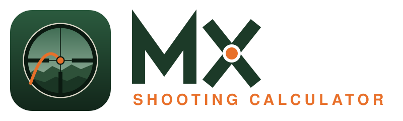

# MX Shooting Calculator (MXSC)

A Rust app (egui + wgpu) for rifle ballistics, for hunting and target
shooting. It runs on the desktop and in the browser. You keep your rifles
and the bullets you shoot in them in a local database, and the calculator
gives:

- a dope table, with holds in mil or MOA and scope clicks;
- energy and velocity at impact, and an ethical range limit set by the
  game you hunt;
- point-blank range for your zero, and the zero that maximises it, told
  the way it is shot in ("13 cm high at 100 m") with a button to make it
  the rifle's zero;
- lead for moving game;
- the view through your scope and a 3D view of the shot, with game animals
  and sport targets at true size.

## Run

```sh
cargo run --release      # the app
cargo test --workspace   # all tests
```

The program is called `mxsc`. Its database is stored in the platform's
app-data folder: on macOS that is
`~/Library/Application Support/MX Shooting Calculator/mxsc.sqlite`. To use
another file, pass `--db /path/to/file.sqlite` or set `MXSC_DB`.

The app was called Malx Hunting Calculator, and before that Ballistic
Calculator. If no database exists yet but one from an earlier name does, it
is copied over on first start; the old file is left in place. Backups
exported under the earlier names still import.

### Web version

The same app runs in a browser (WebAssembly). Each release is published at
**https://malx122.github.io/mx_shooting_calculator/** by
`.github/workflows/pages.yml`. To build it yourself:

```sh
scripts/web.sh           # serve on http://127.0.0.1:8080, rebuilding on changes
scripts/web.sh build     # release build into crates/app/dist: static files to host
```

It needs rustup with the browser target, [trunk](https://trunkrs.dev) and
`llvm-ar`. On macOS:

```sh
brew install rustup trunk llvm
$(brew --prefix rustup)/bin/rustup toolchain install stable --target wasm32-unknown-unknown
```

The script puts rustup's toolchain first, because Homebrew's own Rust can't
build for the browser. It also uses `llvm-ar`, because macOS's `ar` can't
archive the WebAssembly build of SQLite. Plain `cargo` and the desktop app
are unaffected.

How the web version differs from the desktop one:

- **Storage:** SQLite runs in the page. The database is kept in the
  browser's IndexedDB, so it survives reloads and restarts, but it belongs
  to that browser and site. Changes are written back a moment after they are
  made. Use Export/Import to move data between browsers and devices.
- **Export/Import:** Export downloads `mxsc-backup.json`. Import opens the
  browser's file picker (JSON exports and Strelok `.srl` backups).
- **Drawing:** WebGPU where the browser has it, otherwise WebGL.
- **Size:** about 9 MB of WebAssembly, 3.6 MB gzipped or 2.6 MB with brotli.
- **Installable and offline:** a web app manifest and a service worker
  (`crates/app/manifest.webmanifest`, `crates/app/sw.js`, icons in
  `crates/app/assets/pwa/`). "Add to Home Screen" gives an app icon and a
  full-screen app; after the first visit it opens without a connection. The
  page is fetched from the network first, so a new release loads as soon as
  there is a connection. The app asks the browser to keep its data.

### On a phone

Below 640 points of width (any phone, and a narrow desktop window) the app
switches to a one-column layout with bigger text and touch targets
(`mobile.rs`, `calculator/phone.rs`):

- **Navigation:** a bottom tab bar (Calculate, Rifles, Bullets, Targets) and
  a compact header whose menu holds Units, Import, Export, Load demo data,
  Install and the version.
- **Calculate, results first:**
  - The rifle and bullet line opens a Conditions page with every input.
  - Under it are quick fields for **range**, **shot angle** and **wind**.
  - Then the holds, and the scope view with the **target** button beside
    it, its edge following the eyepiece's rim.
  - Trajectory (2D/3D), dope table and limits fold out below.
- **Pickers:** sheets that slide up from the bottom.
  - **Range:** a drag ruler, ± steps, and distances from the dope table plus
    recent ranges.
  - **Shot angle:** an inclinometer dial and presets. In the browser, "Measure
    with the phone" reads the phone's tilt. The rifle's **cant** is set here
    too.
  - **Wind:** a clock dial for the direction and quick speeds.
  - **Target:** search, recent targets, and **No target** (just the reticle
    and the impact point).
- **Rifles, Bullets and Targets:** a list, then the record full screen with
  a way back.

### Versions and releases

Versions follow [Semantic Versioning](https://semver.org), MAJOR.MINOR.PATCH:
fixes raise the patch number, new features the minor number. While the
version starts with 0, any release may still change things noticeably. The
version is set once, in the workspace `Cargo.toml`, and shared by all
crates. The app shows it next to the logo; hover for the commit it was built
from.

To make a release:

1. Move the notes under "Unreleased" in [CHANGELOG.md](CHANGELOG.md) to a new
   version heading, and set the same version in `Cargo.toml`. The changelog
   is compiled into the app and shown under **What's new** (click the
   version number; on a phone, in the menu), so write it for hunters. A
   test fails if `Cargo.toml`'s version has no heading in it.
2. Commit, then tag and push: `git tag v0.2.0 && git push origin main v0.2.0`.
3. The tag builds and publishes the web version. The workflow refuses a tag
   that doesn't match `Cargo.toml`.

The backup format (`transfer::VERSION`) and the database schema (the
migrations in `db.rs`) have their own numbers. Only a change that stops old
backups or databases from loading needs a new major version.

### Development data

`dev-data/sample.json` is a fixture in the app's export format with:

- a **CZ 457** in .17 HMR, with two CCI loads from the catalog and a Kahles
  HELIA 3 4-12x44i with the G4B reticle (second focal plane, ballistic bars);
- a **Tikka T3** in .223 Rem, with two factory loads from the catalog and a
  Kahles K318i with the SKMR4 (first focal plane, mrad);
- a **Browning X-Bolt** in .308 Win, with two factory loads, a handload, a
  velocity measured in that rifle, and a Kahles HELIA 2,4-12x56i with the
  4-Dot.

```sh
cargo seed   # (re)create target/dev.sqlite from the fixture
cargo dev    # run the app on target/dev.sqlite; your real database is untouched
```

Both shortcuts are defined in `.cargo/config.toml`; run them from the
repository root.

To change the sample data:

1. Edit it in the app (`cargo dev`).
2. Choose **Export…**.
3. Save over `dev-data/sample.json`.

`cargo test` checks that the fixture still imports and that its catalog links
resolve. The seed command only replaces `target/dev.sqlite`; given any other
path that already exists, it refuses unless you pass `--force`.

## Brand

The vector source files are in `branding/`:

- **`mxsc-icon.svg`:** the app icon. It shows the view through a rifle
  scope: a German #4 reticle over a forest ridge, with a blaze-orange
  trajectory arcing into the aim point.
- **`mxsc-logo.svg`** (for light backgrounds) and **`mxsc-logo-dark.svg`:**
  the icon with the MX wordmark and the "Shooting Calculator" tagline.

The wordmark is drawn from straight strokes, so it needs no font; the X's
crossing is the orange aim point. Only the tagline uses a system font.

The app uses `crates/app/assets/`: the icon and a light wordmark for the dark
header. They are rendered from SVG at whatever size is needed, including the
window and dock icon, so no bitmaps are stored. The colors are defined in
`crates/app/src/theme.rs`:

| Name | Hex | Use |
|---|---|---|
| Forest | `#12261A` – `#2B5A3E` | backgrounds, panels |
| Bone | `#F1EADB` | text, the wordmark |
| Blaze | `#E8702A` | accent, selection, the trajectory |
| Meadow | `#7FC08C` | the vital zone in the plot |

## How it is used

1. **Rifles:** add each rifle with:
   - its caliber, from a searchable list of about 50 common calibers;
   - twist, sight height, scope and click value. The scope comes from the
     catalog or from **My scopes**: scopes you enter yourself, with
     magnification range, focal plane, the magnification the reticle is true
     at, clicks, elevation travel, field of view and illumination. A custom
     scope is drawn with a catalog reticle you choose, or a plain crosshair;
   - the zero and the weather it was made in: temperature, powder
     temperature, pressure and humidity. The zero can be a height at its
     range, the way many hunters zero ("4 cm high at 100 m"): the bullet
     then hits that high there instead of on the crosshair;
   - its **dope table**: start, end and step, and which columns to show.
     Drop and wind can each be shown in cm, mil, MOA or clicks, alongside
     velocity, energy and time of flight.
2. **My bullets:** build your collection.
   - **From the catalog:** pick a caliber, then factory ammunition in that
     caliber or a component bullet that fits its bore. Adding one makes your
     own editable copy. Handloads need your own muzzle velocity before they
     can be saved.
   - **Manually:** for anything not in the catalog. A bullet can have up to
     five **BCs by velocity band**, interpolated by speed through the air.
   - **Own drag curve:** a bullet can use its own measured drag curve (Mach
     against Cd, for example a maker's Doppler-radar data) instead of G1/G7
     and a BC. Enter points or paste a whole table: spaces, tabs, commas,
     semicolons and decimal commas are all read. With its own curve the
     bullet needs no BC; the engine uses its mass and diameter.
3. **Calculate:** choose a rifle. Only bullets *in your collection* loaded in
   that rifle's caliber can be chosen. **"This bullet in this rifle"** holds
   what is specific to that combination:
   - **Measured velocities:** chronograph averages at different temperatures.
     Two or more give the rifle's own temperature sensitivity, fitted as a
     line.
   - **Point of impact:** where this load hits relative to the load the rifle
     was zeroed with, at the zero range. The engine tilts the bore by that
     angle.
   - **Zero weather:** the rifle's, the same as today, or recorded values.
   - **Truing:** after a long shot (300 m or more works best), enter the
     range and what it took to hit centre, in that day's weather. The
     engine finds the muzzle velocity (when you have no chronograph) or the
     drag (when the velocity is measured, so the BC is the doubt) that
     matches, and uses it from then on. The AI tools use it too.

   Edits apply to the calculation immediately and are kept when saved.

   **Weather:** **📍 Weather here** (on a phone or in a browser that may
   know your position) or a place search fills in the temperature,
   sea-level pressure and the ground's height, humidity and the latitude,
   from [Open-Meteo](https://open-meteo.com) (MET Norway's model in the
   Nordics). The forecast wind (10 m above open ground) is turned into a
   clock direction from the direction you shoot: type it, or on a phone
   hold the phone flat with its top edge towards the target and press **🧭
   Point the phone**. **Use the wind** brings it down to shooting height
   (about 70 % over open ground; less in forest, so adjust it). On a phone
   the wind picker offers the forecast wind too.

   **Target and ethics:** choose what you shoot at, either game or a sport
   target. The target sets the vital zone (or, on a sport target, the hit
   zone) and, for game, the minimum energy. You can change either for this
   calculation; ↺ goes back to the target's value. Sport targets have no
   ethical limits. The target is drawn at true size through the scope and in
   3D. When the target is game in your country, the results say whether
   your load meets the **legal rifle ammunition level** for it, worked out
   from the bullet's weight, whether it expands, lead-free or not, and its
   energy at the muzzle and at 100 m. A bullet whose construction isn't set
   (a Strelok import, say) is assumed to expand, and the result says so.

   **Hunting today:** for game, with your country set, the target section
   shows the season in your county (Sweden's län, Finland's maakunnat), from
   the weather place search or picked from the list: open until when, or when
   it opens, for which animals and with which method limits. It also shows
   today's legal shooting light where you are (sunrise and sunset worked out
   offline for your position), and whether it is allowed right now. In
   Sweden that is from an hour before sunrise to an hour after sunset for
   moose, deer, wolf, lynx and wolverine (the last hour only stalking or
   watching), and to two hours before sunset for bear, by Jaktförordningen
   9 §. In Finland only ducks and geese have such hours. The Targets page
   shows each species' whole season table, the law's own words with links,
   and the sources. The data is the law as of its date: check before you
   hunt. How it is made and updated: [tools/hunting](tools/hunting/README.md).

   **Hunting rules** (the flag in the header; on a phone, in the menu)
   chooses the country: **Sweden** (Naturvårdsverket, NFS 2023:8, classes
   1–4), **Finland** (Metsästysasetus 666/1993 § 16 a: moose, deer, roe
   deer, fox and small game classes) or **none** for no legal checks. It
   starts from the device's language and region. Each country's rules are a
   file of their own in `crates/ballistics-store/src/rules/`; adding a
   country means adding a file and its levels to the targets.

   The **Trajectory** can be shown in 2D (a graph of drop and wind drift) or
   in 3D. The 3D view is a true-scale scene: a hunter at the muzzle, the
   target at the target range with its vital zone ringed, the
   bullet's path, the line of sight, the wind and distance marks. Drag to
   orbit, right-drag to pan, and ⌘/Ctrl + scroll or pinch to zoom. The
   buttons jump to set views: Overview, Behind the shooter, From the side,
   At the target and From above. Double-click to return to the overview.
   It is drawn with egui's painter, so it needs no 3D library. Because the
   scene is true to scale, the hunter and the target are small at long range
   in the wide views.
4. **Targets:** the catalog's game animals and sport targets, and **My
   targets**. The catalog has every species on Svenska Jägareförbundet's
   list of Swedish hunting seasons and Finland's game species (Metsästyslaki
   § 5), in folding groups (deer; wild boar and mouflon; bear, wolf, lynx and
   wolverine; fox, badger, martens and otter; hares, beaver and rodents;
   seals; grouse, ptarmigan and pheasant; ducks, geese and swans; other
   birds; sport). Search finds them by English, Swedish or Finnish name. Each species has
   its own drawing of the male (birds in the plumage they have in the
   hunting season); species that look alike share one, such as the grey
   geese or the gulls. Sizes and vital zones are estimates. Each species
   shows, with your country's flag, the least rifle ammunition its law
   allows for it, and what else the law says (a shotgun allowed too, a
   licence needed, protected). Copy a catalog target to adjust it, or make a new one:
   - an animal: drawn as any of the catalog's animals, at your size, with
     or without antlers or horns. Birds and small animals are measured to
     the top of the back, and birds from beak to tail;
   - a paper target with rings: innermost ring, ring spacing, number of
     rings and black;
   - a steel plate.

   Each target has a vital or hit zone. Game has a minimum energy and can
   have its own minimum velocity. That velocity replaces the bullet's
   expansion velocity and your general one; small game sets none, since
   it doesn't need expansion.
5. **Cards:** printable cards for the rifle, bullet and target chosen in
   Calculate, in today's weather. The preview is the card as it prints;
   **Save PDF** saves it (on the desktop it then opens in the PDF viewer;
   on a phone it goes to the downloads, ready to print or keep).
   - **Dope card:** what to dial or hold at each range. Pick the size
     (a bank card, A7, A6, A5 or A4, portrait or landscape; small cards
     can fill an A4 sheet with cut lines), the ranges (or a quick choice:
     to the ethical limit, driven hunt, stand, long), one or more
     temperatures (an elevation column each: autumn, winter, all year),
     elevation as clicks, mil or MOA, or cm, wind columns for chosen
     speeds, and speed, energy and time of flight. The text is made as
     large as the card allows, and a meter says whether it is easy to
     read, small, or too small. A red line marks the ethical limit and a
     green bar the ranges where a dead-on hold stays in the vital zone.
   - **Stand card:** a map of a hunting stand, facing its direction, over
     90°, 180° or all round: range rings with the hold at each, the
     dead-on zone in green, beyond the ethical limit in red, the shooting
     sector the hunt leader gave (outside it greyed) and the directions
     never to shoot (roads, houses, the next stand) hatched. Landmarks
     with their range and direction are marked on the map and listed with
     their hold; on a phone, 🧭 takes a direction from the compass. Spare
     room becomes lines for notes. Stands are kept on the device.
   - **Turret label:** a strip to wrap round the elevation turret, with
     the ranges at the clicks they need. Measure the turret once (diameter
     over the knurling and height with a caliper, clicks a turn, which way
     it turns when dialling up) and say what the label is printed on: it
     bends round its own middle, so the strip is made π × its thickness
     longer (0.3 mm for paper, nearly 1 mm laminated) and its ends meet. It
     is kept for the rifle. The marks come from the
     calculation at today's temperature, the zeroing temperature or a
     chosen one: a number every 10, 25, 50 or 100 m (as "1 2 3", "10 11 12"
     or "100 110 120"), lines and dots between, optionally a tick or a
     triangle under each number at its exact click, and a band for each
     turn of the turret. Under them is a ruler with a tick for every click
     and the mil (or MOA) numbered. Lettering: Helvetica or one of four
     bundled fonts (Barlow Condensed, Bebas Neue, Share Tech Mono, Black
     Ops One; SIL Open Font License, embedded in the PDF), and the
     numbers' size. Colours: a scheme to start from, then the background
     and marks of the label, the description, each turn's band and the
     ruler, a colour for beyond the ethical limit, and any single range a
     colour of its own. Marks that would overlap are left off and listed.
     The A4 sheet has copies of the strip with cut marks, a 50 mm bar to
     check the print scale, and the clicks for every range.

**Units** (in the header): metric or imperial for each quantity separately.
Distance, drop, sight height, velocity, wind speed, temperature, sensitivity,
pressure (hPa, mmHg or inHg), altitude, energy, bullet weight, length,
diameter, barrel length and twist can each be set. Values are always stored
in metric, so changing units never changes your data.

**Export… / Import…** save and merge your rifles, bullets, rifle loads,
custom scopes and custom targets as JSON. **Import…** also reads **Strelok Pro backups
(`.srl`)**. It shows what it will add, with each rifle's inferred caliber to
check, before writing anything, and importing the same backup again adds
nothing. See [docs/strelok-import.md](docs/strelok-import.md). Import merges record by record and keeps whichever copy was edited
last, so the same file can move data between devices. Backups from earlier
versions (formats 1 to 4) still import. Restoring a backup brings back
records deleted since.

**Sync** (in the header; in the phone's menu) keeps your rifles, bullets,
loads, scopes and targets the same on all your devices, in one of two ways:

- **With Google Drive:** **Sign in with Google** on each device, with the
  same account. The data is kept in a hidden folder in your own Drive that
  only this app can reach.
- **With a sync key, no account:** **Start syncing with a key** on the first
  device. It shows the key with a QR code; scan it on the next device (it
  opens the app with the key) or type the key under **Join**. The data is
  encrypted on the device before it is sent, so the sync server
  ([server/](server/README.md), a small Cloudflare Worker) can't read it.
  Keep the key to yourself: anyone with it can read and change the synced
  data.

A device that joins has its own data merged in. From then on the app syncs
when it starts, a moment after each change, when it comes back to the front,
and every few minutes; changes made offline go up later. When the same
record is changed on two devices, the later change wins; a deletion and a
later edit work the same way. **Stop syncing here** leaves the device's data
as it is; **Delete the synced copy** turns sync off on every device. Units
and calculator inputs stay per device.

## AI assistants

`mxsc-mcp` lets an AI assistant answer questions with the app's own engine
and your own rifles: "what's the holdover for my Tikka at 280 m, 4 m/s from
the right?", "make me a dope card for the X-Bolt", "is my .243 load legal for
roe deer?". It is an [MCP](https://modelcontextprotocol.io) server, so it
works with any assistant that supports MCP: LM Studio or Jan with a local
model, Claude Desktop, Claude Code and others.

The assistant gets these tools (read-only for now):

| Tool | What it does |
|---|---|
| `list_rifles`, `list_bullets`, `list_targets` | Your rifles (with scope, zero, clicks and measured bullets), your bullets, and the game and sport targets (search by English, Swedish or Finnish name) |
| `holdover` | Elevation and windage to dial or hold at a range, in the scope's units and clicks, with drop, drift, velocity and energy; with a target, whether the shot is inside the ethical range and meets Swedish ammunition rules |
| `dope_table` | The same over a span of ranges |
| `search_catalog` | The bullet catalog |

Names can be loose ("tikka", ".308", "rådjur"); when a name fits several
records the tool says so instead of guessing. Without a bullet it takes the
one last used with the rifle. The weather is the one last entered in the
app's calculator unless the assistant gives its own, wind and angle are none
unless given, and every answer says which conditions it used.

It reads the desktop app's database. With sync on in the desktop app, what
you add on your phone reaches it whenever the desktop app runs.

**Set up.** Build and install it once:

```sh
cargo install --path crates/mxsc-mcp      # installs ~/.cargo/bin/mxsc-mcp
```

Then tell your assistant to start it (use the full path):

- **LM Studio:** Program → Install → *Edit mcp.json*, then add
  `{"mcpServers": {"mxsc": {"command": "/Users/you/.cargo/bin/mxsc-mcp"}}}`.
  Pick a model that is good at tool calls (Qwen 3, Llama 3.1 or newer, 7B
  or larger).
- **Claude Desktop:** Settings → Developer → *Edit config*, and add the same
  `mcpServers` entry to `claude_desktop_config.json`.
- **Claude Code:** `claude mcp add mxsc -- ~/.cargo/bin/mxsc-mcp`.

Add `"args": ["--db", "/path/to/file.sqlite"]` to use another database, for
example `target/dev.sqlite` for the development data.

**While developing,** register `scripts/mxsc-mcp.sh` instead of the installed
copy. It rebuilds the server when the code has changed and then starts it,
so the assistant always gets the current version (from its next session, or
after it restarts the server):

```sh
claude mcp add --scope user mxsc -- "$PWD/scripts/mxsc-mcp.sh" --db "$PWD/target/dev.sqlite"
```

## Code layout

| Crate | What it does |
|---|---|
| `crates/ballistics-core` | The physics engine: a 3-DOF point-mass solver with G1/G7 drag, atmosphere, wind, shot angle, cant, spin drift, aerodynamic jump, Coriolis and the hunting analyses. No dependencies, no I/O. |
| `crates/ballistics-store` | The base catalog, the SQLite database (with schema migrations), JSON export/import, and the sync merge and encryption (`sync.rs`). No UI, no networking. |
| `crates/app` | The egui screens, for desktop and the web (`web.rs`, `index.html`). Pages return actions instead of writing to the store, so the logic can be reused by another front end. `sync.rs` and `http.rs` run sync rounds in the background. `cards/` lays out the printable cards once, in millimetres, for both the preview and a hand-written PDF (Helvetica, nothing embedded). |
| `crates/ballistics-shot` | A shot from the hunter's records: the engine's scenario from a rifle, bullet, measured velocities and conditions, holds in the rifle's clicks, and the legal ammunition check for the hunter's country. Shared by the app and `mxsc-mcp`, so both give the same answers. |
| `crates/mxsc-mcp` | The MCP server for AI assistants (see above). |
| `server` | The sync server: a Cloudflare Worker with a D1 database. See [server/README.md](server/README.md). |

`ballistics-core` and `ballistics-store` build on desktop and mobile targets
(SQLite is compiled in), and in the browser, where SQLite is compiled to
WebAssembly. The app crate builds for desktop and the web. Its few
platform-specific parts (data folder, file dialogs, start-up) are behind
`cfg(target_arch = "wasm32")`.

### How sync merges

Every record has a UUID and an `updated_at` time; deletions are kept too
(the `deleted` table), so they reach the other devices instead of the record
coming back. A merge keeps the later of two copies, and on equal times
compares them, so every device settles on the same one. Times come from a
clock that never runs behind anything the store has seen, so a device whose
clock is slow still stamps its edits after the copies they were made from.
The shared copy is the usual export (format 5): encrypted on the sync
server, which checks versions so two devices writing at once can't overwrite
each other; plain in Google Drive, which can't check versions, but a device
whose write is overwritten still has its records and puts them back on its
next round.

## Scopes and reticles

`crates/ballistics-store/catalog/scopes/` (one file per maker) and
`reticles.json` hold scope specifications and reticle geometry. Reticles
stay in one file because makers' scopes can share a reticle. They cover three makers:

- **Kahles:** 8 scopes with their 4-Dot, G4B, 4-DH and SKMR4 reticles drawn.
  Kahles publishes dimensioned drawings for every hunting reticle.
- **Vortex:** 43 scopes from Crossfire HD, Diamondback (and Tactical),
  Strike Eagle, Venom, Viper HD, Viper PST Gen II, Razor HD Gen III and
  Razor HD LHT.
  - **Reticles:** 26 Vortex reticles are drawn, with one entry per scope
    where Vortex publishes per-model values. Each reticle's notes say what
    was published and what was measured from the picture or assumed; line
    widths were often assumed.
  - **Gaps.** Vortex loads many of its spec tables dynamically, so some
    fields are missing. Where the field of view is missing, the scope view
    estimates it from the magnification. Missing click values on scopes
    from 2× up are set to Vortex's standard ¼ MOA or 0.1 MRAD, which the
    notes say.
  - **Not cross-checked.** This data was collected in one quick pass.
- **Delta Optical:** 42 scopes from Titanium HD, Titanium, Classic, Entry,
  Javelin, Stryker HD and Hornet, with 17 of their reticles drawn (4A S,
  4A SB, 2D, Mil-Dot, Multi-X, SMR-1/2, SDOG-1, DLR-1, LRD-1P, DLS-1/2/3,
  DSMR, DGMR, D²BR, D²MR).
  - **Sources.** Delta's own sites (deltaoptical.pl and the older
    deltaoptical.eu with its dimensioned reticle sheets), Delta's user
    manuals, and optics-trade.eu for a few gaps; each entry's notes say
    which.
  - **Estimates.** Several Delta pictures carry no dimensions (4A S, 2D,
    Mil-Dot, Multi-X, SDOG-1): their angular size is estimated and the
    notes say so. Where Delta doesn't say at which magnification a
    second-focal-plane reticle is true, the top magnification is assumed.
  - **Not drawn.** Delta publishes nothing to draw SKR-1/2, DLR-3, Di MD,
    2D FFP or the Javelin's 4A SB from, so those scopes offer the plain
    crosshair.

**How reticles are drawn.** Every reticle is the project's own drawing:
code builds it from the subtension figures the maker publishes (spacings,
line widths, hold-point positions), and what the maker doesn't print is
measured from the maker's published picture. Nothing is traced or copied
from the makers' vector artwork.

**Reticle format.** A reticle is a list of vector shapes in angular units
around the aiming point (x to the right, y up):

- `line`, with its thickness, or `null` for a hairline;
- `polygon`, filled, for heavy posts;
- `circle`, as a dot or a ring.

The `unit` is whatever the maker publishes: `mrad`, `moa` or `cm_at_100m`.
Elements that reach the edge of the view extend to ±500 and are clipped to
the field of view. Parts that light up carry `"illuminated": true`.

**One entry per drawing.** Scopes that share a reticle point to the same
entry, which lists them in `for_scope`. Before drawing a new reticle, match
it against the ones already there. When entries are merged, `replaces`
keeps the old ids so rifles and backups that name them still work. A test
fails when two entries have the same drawing.

**Every name is searchable.** When one drawing is sold under several names
(for example the Illuminated Dead-Hold BDC and the Dead-Hold 2A), the extra
names go in `also_known_as`. Searching for a reticle finds it by its name,
`maker_reticle_name` or any of those names, ignoring case, spaces and
dashes. That works when choosing a reticle for your own scope, and in the
scope picker, which also finds catalog scopes by reticle name.

**Second focal plane.** On these scopes the marks are true only at one
magnification, stored as `reticle_reference_magnification`. Because the real
size of a reticle differs between scope models, Kahles publishes one value
table per model, so the catalog has one reticle entry per scope (for example
"4-Dot (HELIA 2,4-12x56i)").

**In the app:**

- A rifle has a scope and reticle (Rifles page). Choosing a scope fills in
  the click unit and value.
- The calculator shows **Through the scope**: the reticle at the chosen
  magnification, the impact point for a dead-on hold (the orange dot to hold
  on the target), and the target with its vital zone at true size.
- The view is the scope's real field of view at the magnification set on
  the slider under it. On second-focal-plane scopes the slider marks the
  magnification where the reticle's marks are true; double-click it to jump
  there. The elevation can be held or dialled, and illumination switched on
  or off.
- At other magnifications, second-focal-plane reticles are scaled
  correctly.

**Caveats in the data.** Most dimensions come from Kahles' tables. A few were
drawn rather than published, and each reticle's `notes` say which:

- the start of the 4-Dot bottom post;
- the SKMR4 holdover-tree widths, measured from Kahles' scale drawing.

The HELIA 1-5x24i's click value is not published.

## The base catalog

`crates/ballistics-store/catalog/` holds the catalog as JSON compiled into the
app:

- **`calibers.json`:** about 50 calibers, each with bullet diameter and a
  typical twist.
- **`bullets/`:** 225 bullets and loads, one file per maker (for example
  `bullets/norma.json`). These are factory loads from Norma, Lapua, Sako,
  Hornady, Barnes, Geco, Federal, CCI, Remington and Winchester, and
  component bullets from Hornady, Nosler, Sierra, Barnes, Lapua and Norma.
- **`scopes/`:** scopes, one file per maker; see below.

  A new maker only needs a new file: the build script compiles in every
  `.json` file in these folders, in name order. A file holds only its own
  maker's entries, named after the maker in lower case (a test checks it).
- **`reticles.json`:** reticle geometry, in one file since scopes from
  different makers can share a reticle.
- **`targets.json`:** every Swedish game species, a few others (elk,
  white-tailed deer) and sport targets (ISSF 300 m, 50 m and 10 m rifle
  targets; 10, 20 and 30 cm steel plates), each in a list group. Each
  species has its rifle level per country (`"ammunition": {"sweden": 2,
  "finland": 3}`) and what else each country's rules say (`rules_notes`).
  Older files with `swedish_class` still read.
- **`drawings.json`:** the animal drawings the targets use, as coloured
  polygons in metres.

  The animals' vital zones and minimum energies are common **guidelines**,
  not law. Legal rules differ by country and are often stated differently
  (for example as energy at 100 m). Check your own country's rules and adjust
  or copy the target. The ISSF ring sizes follow the ISSF rules.

Most entries come from the manufacturer's own pages. Hornady and Winchester
don't publish BCs for their .17 HMR loads, so those four entries take their
BC from retailer pages: at least two independent sources had to agree, and
each entry's notes list them.

Every entry carries the manufacturer page it came from (`source_url`) and the
date it was checked. Values that a manufacturer does not publish are left
empty rather than estimated: bullet length (often), G7 BC, and minimum
expansion velocity.

A test (`builtin_catalog_is_consistent`) checks every entry:

- known caliber keys;
- diameters that fit a caliber;
- plausible BCs and velocities;
- grams matching grains;
- https sources.

Edit the JSON directly and run the tests.

### Known caveats in the data

- **Sako, Geco, CCI, Remington and Federal (partly)** don't say whether
  their BC is G1 or G7. The values are stored as G1, which matches the
  published velocity tables and is the usual convention for rimfire.
- **Lapua Naturalis** has unusually low published G1 BCs (for example 0.201
  for the 6.5 mm 140 gr). Lapua's own velocity tables confirm them.
- **Bullet length** is missing for most factory loads. Without it the app
  cannot compute stability, spin drift or aerodynamic jump and says so;
  enter the length if you know it.
- **RWS is not included:** its website asks AI crawlers not to collect its
  pages.

## Physics validation

`crates/ballistics-core/src/tests.rs` checks analytic limits and physical
behaviour. It also checks agreement with py-ballisticcalc 3.1.1, an
independent solver: drop agrees within 0.1 cm at 1000 m on level shots.

Two effects are added to the point-mass flight:

- **Aerodynamic jump:** a crosswind throws a spinning bullet slightly up or
  down as it leaves the muzzle. The app uses Bryan Litz's fit,
  (0.01·Sg − 0.0024·L + 0.032) MOA per mph of crosswind, with Sg the
  stability and L the bullet's length in calibres: with a right-hand twist,
  wind from the left lifts the bullet and wind from the right lowers it.
  It needs the bullet's length, and can be switched off.
- **Cant:** a rifle tilted about the line of sight turns the bore's own
  geometry (its height under the scope and its angle up to the line of
  sight) with it, while gravity and wind stay put. A dead-on hold then
  lands to the side of the tilt and a little low, by the bore line's height
  over the line of sight times the sine of the cant (5° at 300 m: a few
  centimetres). The holds are worked out for the tilted reticle, and the
  calculator says how far a level shot would differ.

A point-mass model with one BC is very good at hunting ranges, but it is only
as good as the BC and muzzle velocity you give it. Chronograph your rifle and
confirm your dope on paper at real distances before hunting. The energy and
velocity limits are yours to set; check your bullet maker's expansion data and
your country's legal ammunition requirements.

## License

The source code is licensed under either of the
[Apache License, Version 2.0](LICENSE-APACHE) or the [MIT License](LICENSE-MIT),
at your option. This is the usual dual licence for Rust projects.

- **Third-party libraries** are listed with their licences in
  [THIRD-PARTY-LICENSES.txt](THIRD-PARTY-LICENSES.txt). Ship that file with
  any binary. All of them are permissive except `resvg`/`usvg` and
  `option-ext` (MPL-2.0: changes to those files must be shared) and the
  fonts egui bundles (SIL Open Font License and Ubuntu Font Licence). The
  desktop app's list of trusted certificate authorities (`webpki-roots`) is
  under CDLA-Permissive-2.0, which only asks that its licence text comes
  along. The sync server's tooling (`wrangler`) is only used to build and
  deploy it and doesn't ship. Regenerate the file after changing dependencies:
  `cargo about generate about.hbs -o THIRD-PARTY-LICENSES.txt` (install
  with `cargo install cargo-about --locked --features cli`).
- **The card fonts** in `crates/app/assets/fonts` (Barlow Condensed, Bebas
  Neue, Share Tech Mono, Black Ops One, from Google Fonts) are under the SIL
  Open Font License 1.1; each font's licence and copyright is next to it.
  They are embedded in the PDFs the app makes, which the licence allows.
- **The built-in catalog** (see [NOTICE](NOTICE)): bullet and scope figures
  are facts compiled from manufacturers' publications, each with its
  source. The reticle and animal drawings are the project's own: the
  reticles are built by the project's code from the subtension figures the
  makers publish, not traced from their artwork. The project's own parts
  are under the same licences as the code. Product and reticle names are
  their owners' trademarks.
