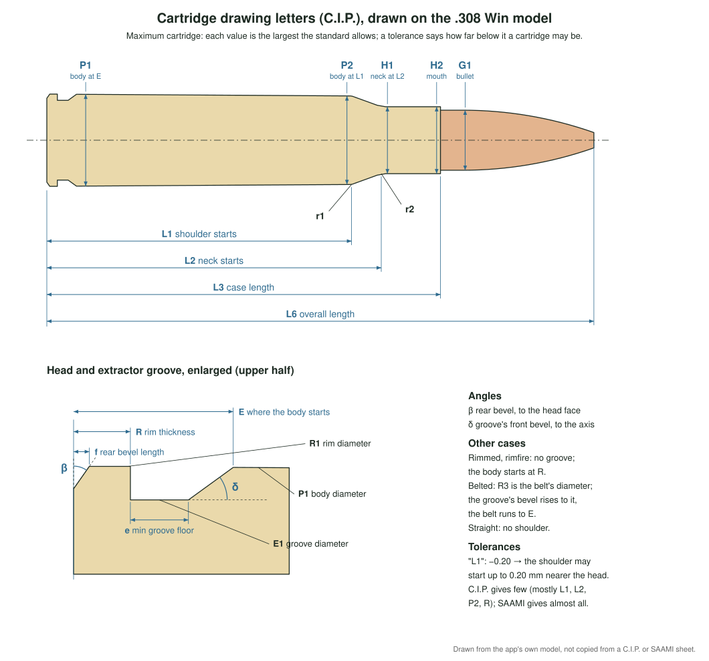

# Cartridges: the 3D model and its measurements

Every caliber in `crates/ballistics-store/catalog/calibers.json` has a
`cartridge`: the outside of a loaded round. The app draws it in 3D in the
bullet catalog and the rifle editor, and saves it as an STL for 3D-printed
dummies, to try magazines and feeding. The code is
`crates/ballistics-store/src/cartridge.rs`; its doc comments define each
field. The printed file is made in `print.rs` beside it, which the app and
the MCP server (`save_cartridge_stl`) share.



The drawing is the app's own, made from its model by
`tools/cartridge-drawing.py`. It is not copied from a C.I.P. or SAAMI sheet,
which may not be reproduced.

## What is stored

**The case is the largest the standard allows.** Each value comes from the
"cartridge maximum" column of the caliber's C.I.P. data sheet (TDCC). C.I.P.
publishes them, listed by type at
<https://bobp.cip-bobp.org/en/tdcc_public?cartridge_type_id=1> (1 rimless,
2 rimmed, 3 belted, 5 rimfire). Where C.I.P. has no sheet, or leaves a value
blank, the value comes from the ANSI/SAAMI Z299.4 (centrefire rifle) or
Z299.1 (rimfire) drawing. The cartridge's `source` names the sheet, its
revision, and anything taken from elsewhere.

Two values are minimums on purpose, because they also give the largest
outline: the groove's floor (`e min`) and the body-to-shoulder rounding
(`r1 min`).

**The bullet is a typical one, not a maximum.** Its diameter is the
caliber's bullet diameter, never over the drawing's maximum G1. Its length
comes from the app's bullet catalog or the bullet's maker, where one is
published. Berger's reference chart gives the nose and boat-tail lengths for
Berger bullets. Everything else about its shape is estimated, and its
`source` says what. It is seated so that the tip is at the drawing's maximum
overall length (L6). Factory ammunition is usually a little shorter.

## The letters

| Letter | What it is | Field in `cartridge` |
|---|---|---|
| R | rim thickness | `case.rim_thickness` |
| R1 | rim diameter | `case.rim_diameter` |
| f, β | the rim's rear bevel: its length along the axis, and its angle **to the head face** | `case.head_bevel.length`, `.degrees` |
| E1 | extractor groove diameter | `case.groove.diameter` |
| e min | shortest groove floor | `case.groove.floor_min` |
| δ | the groove's front bevel, its angle **to the axis** | `case.groove.bevel_degrees` |
| R3 | belt diameter (belted cases) | `case.belt_diameter` |
| E | from the head to where the body starts | `case.body_start` |
| P1 | body diameter at E | `case.body_diameter` |
| L1, P2 | where the shoulder starts, and the body's diameter there | `case.shoulder.start`, `.diameter` |
| L2, H1 | where the neck starts, and its diameter there | `case.shoulder.neck_start`, `.neck_diameter` |
| r1, r2 | the roundings where the body meets the shoulder and the shoulder meets the neck | `case.shoulder.radius`, `.neck_radius` |
| H2 | diameter at the case mouth | `case.mouth_diameter` |
| L3 | case length | `case.length` |
| L6 | overall length, head to bullet tip | `overall_length` |
| G1 | bullet diameter | `bullet.diameter` (at most G1) |

L1 and L2 are where the straight lines meet, as on the drawings. The
roundings r1 and r2 cut the corners.

**Other kinds of case:**

- **Rimmed and rimfire:** no extractor groove; the body starts at the rim's
  front, so `body_start` is R.
- **Rimfire:** no primer, and a rim drawn fully round (`rim_radius` = R/2).
- **Belted:** the groove's floor is e min long, and its bevel rises to the
  belt (R3). The belt runs to E, where the body steps in to P1.
- **Straight:** no shoulder (`shoulder` null); the body runs from P1 to H2.
- **Venturi:** a "venturi" shoulder (Weatherby) is two roundings that
  nearly fill the shoulder line.
- **Bodyless shoulder:** a case without a real shoulder, such as 9.3×72R,
  has one lying on its body's own line.

**From a SAAMI drawing:**

- **Rim bevel:** SAAMI gives its angle to the axis, so β = 90° − SAAMI's
  angle. The bevel's length is the rim thickness less the rim's flat part.
- **Body start:** E and P1 are where the groove's bevel meets the tapered
  body.

## The printed copy

**Save for 3D printing (STL)** writes the cartridge in millimetres, standing
on its head, as one closed solid. With **Cut the caliber's name into the
side**, the name is cut 0.4 mm deep into the body:

- **Where:** along the body, from 1.5 mm past E to 1 mm short of the
  shoulder's rounding (or of the mouth on a straight case).
- **How it reads:** towards the tip, the right way round from outside.
- **Size:** about a third of the body's diameter tall, at most 4.5 mm, and
  smaller when the name is long.
- **Long names:** when the name won't fit at 1.5 mm, the caliber's longest
  alias that fits is used instead.

The letters press the body's surface in, so they can't change how a dummy
fits a magazine.

## Tolerances

`tolerances` keeps the tolerances the drawing prints, by its letters:

```json
"tolerances": { "P2": -0.20, "L1": -0.20, "L2": -0.20 }
```

They are all minus values, because the stored value is the maximum.
`"L1": -0.20` means the shoulder may start up to 0.20 mm nearer the head
and still be within the standard.

- **C.I.P. prints few:** mostly L1, L2 and P2 (−0.20 mm), the rim
  thickness R (−0.18 or −0.25 mm), and on some sheets E or L3. A value
  without a printed tolerance has none here.
- **SAAMI prints one on almost every value,** and gives the overall length
  as a range. For SAAMI cases, `"L6"` is the minimum less the maximum.

## Adding a caliber

1. Find its sheet in the C.I.P. lists above (or the SAAMI standard).
2. Copy the cartridge-maximum values into a `cartridge` like the others in
   `calibers.json`, with its `source`, its `tolerances`, and a typical
   bullet.
3. Run `cargo test -p ballistics-store`.

The tests check the cartridge against its own measurements:

- the groove floor that the other measurements give equals e min, which
  catches a misread angle;
- the shoulder's line, the body's taper and the neck pass through their
  points;
- the bullet sits in the case, gripped by the neck;
- the printed solid is closed.
